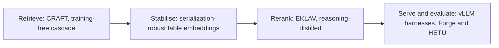

<picture>
  <source media="(prefers-color-scheme: dark)" srcset="https://raw.githubusercontent.com/AdarshSingh7647/AdarshSingh7647/main/assets/banner-dark.svg">
  <source media="(prefers-color-scheme: light)" srcset="https://raw.githubusercontent.com/AdarshSingh7647/AdarshSingh7647/main/assets/banner-light.svg">
  
</picture>

  
  
  
  
  

<b>Skim in two minutes:</b> <a href="#featured-research">CRAFT (ACL 2026)</a> · <a href="#models-and-datasets-on-hugging-face">29 models on Hugging Face</a> · <a href="#open-source-tooling">post-training tooling</a> · <a href="#experience">experience</a>

 

I build the ML stack around language models: post-training and distillation, agent evaluation and harnesses, and retrieval and ranking systems that hold up at 1M+ documents. Co-first author of **CRAFT** (ACL 2026) and **EKLAV** (arXiv), with 29 models and 7 datasets public on Hugging Face (74K+ downloads).

As Founding Engineer (Machine Learning) at **Noah Labs**, maker of Sentinel Studio (an AI IDE for regulated, air-gapped codebases), I benchmark open-weight LLMs as coding agents, rebuild the agent harness for reliability and build verifier-backed RL environments. At **ASU's CoRAL Lab** (advisor: Dr. Vivek Gupta) I research reliable table retrieval and reasoning-aware reranking.

**Open to ML Engineer and Research Engineer roles:** LLM post-training, inference and evaluation infrastructure, retrieval and ranking.

 

<picture>
  <source media="(prefers-color-scheme: dark)" srcset="https://raw.githubusercontent.com/AdarshSingh7647/AdarshSingh7647/main/assets/stats-dark.svg">
  <source media="(prefers-color-scheme: light)" srcset="https://raw.githubusercontent.com/AdarshSingh7647/AdarshSingh7647/main/assets/stats-light.svg">
  
</picture>

## What I work on

<table>
<tr>
<th width="33%" align="left">Train</th>
<th width="33%" align="left">Serve and evaluate</th>
<th width="33%" align="left">Retrieve and rank</th>
</tr>
<tr valign="top">
<td>
<ul>
<li>LoRA SFT and reasoning distillation on Qwen3 and GLM (0.6B to 14B)</li>
<li>Verifier-backed RL environments and outcome rewards (RLVR)</li>
<li>Memory profiling to fit 25K+ token sequences on one GPU</li>
<li>FlashAttention-2 benchmarking; multi-GPU (DDP, NCCL) continued pretraining of a linear-attention hybrid</li>
</ul>
</td>
<td>
<ul>
<li>Agent evaluation: Terminal-Bench 2.0, SWE-bench Lite, DeepSWE, LiveCodeBench v6, SWE-Atlas QnA</li>
<li>Failure analysis with A/A controls and McNemar tests; reward-hacking checks</li>
<li>vLLM serving, throughput tuning, concurrent sandboxed runs</li>
<li>Quantization studies: accuracy vs latency vs memory</li>
</ul>
</td>
<td>
<ul>
<li>Training-free cascades: SPLADE, then dense, then rerank</li>
<li>Hybrid sparse-dense FAISS-HNSW over 1M+ tables</li>
<li>Contrastive fine-tuning (+24% F1)</li>
<li>Embedding robustness through a zero-cost adapter</li>
</ul>
</td>
</tr>
</table>

## Featured research

The three papers below cover one retrieval stack end to end:

### CRAFT: Training-Free Cascaded Retrieval for Tabular QA

 

A three-stage cascade for open-domain table question answering that needs no task-specific training. SPLADE narrows the corpus to 5,000 tables, dense row-level search keeps 100, and an embedding reranker returns the final 50. Table titles and descriptions generated with Gemini 1.5 Flash enrich the index.

- **87.16% Recall@10** on NQ-Tables (96.84% Recall@50), ahead of sparse, dense and hybrid retrievers.
- **Zero-shot on OTT-QA** (400K tables): competitive at higher recall depths, with no fine-tuning.
- **Up to 33× fewer online embedding calls and 70% shorter contexts**, without losing accuracy.

[Paper](https://aclanthology.org/2026.acl-long.149/) · [arXiv](https://arxiv.org/abs/2505.14984) · [Code](https://github.com/coral-lab-asu/CRAFT) · [Project page](https://coral-lab-asu.github.io/CRAFT/) · [Datasets](https://huggingface.co/collections/AdarshSingh7647/craft-training-free-cascaded-retrieval-for-tabular-qa-6a5bcd1a12a6c557c91189f4)

### EKLAV: reasoning as training context, not an imitation target

 

Reasoning distillation usually trains a student to reproduce a teacher's chain of thought and its final answer. EKLAV keeps the teacher's reasoning in the input but supervises only the final answer, moving part or all of the trace into the prompt. It reuses a fixed teacher corpus, needs no student rollouts or iterative teacher feedback, and works for both pointwise and listwise rerankers.

- **BRIGHT passage reranking:** better average nDCG@10 at all four tested checkpoints across two model families (41 of 48 model-domain comparisons won), with up to **31.6% less training compute** and up to **32.7% faster inference**.
- **Table reranking:** best of four conditions on three of four held-out benchmarks, +3.0 points over full-trace distillation and +5.5 over answer-only training on average.
- **Released on Hugging Face:** 29 models and 7 datasets across EKLAV, TabRank and CRAFT. For example, Qwen3-14B reaches 34.7 nDCG@10 on BRIGHT vs 32.5 for standard CoT-SFT.

[arXiv](https://arxiv.org/abs/2607.25182) · [Passage rerankers](https://huggingface.co/collections/AdarshSingh7647/eklav-models-passage-reranking-6a988887d883826e26fbfbe0) · [Table rerankers](https://huggingface.co/collections/AdarshSingh7647/tabrank-qwen3-8b-table-rerankers-6a55919bf667cb41db2dc8b2) · [All models](https://huggingface.co/AdarshSingh7647)

### Improving robustness of tabular retrieval via representational stability

Changing only how a table is serialized (for example to HTML) moves Recall@1 by up to 0.26 across MPNet, BGE-M3, ReasonIR and SPLADE. A residual bottleneck adapter trained with a VICReg-style objective pulls every serialization toward a canonical centroid embedding, at **zero added inference cost**: MPNet HTML Recall@1 goes from 0.09 to 0.18.

[arXiv](https://arxiv.org/abs/2604.24040) · [Code](https://github.com/KBhandari11/Centroid-Aligned-Table-Retrieval)

## Models and datasets on Hugging Face

29 models and 7 datasets, with 74K+ model downloads.

| Collection | What is in it | Highlight |
|---|---|---|
| [EKLAV: passage reranking](https://huggingface.co/collections/AdarshSingh7647/eklav-models-passage-reranking-6a988887d883826e26fbfbe0) | Qwen3 (0.6B to 14B) and GLM-Z1-9B reasoning rerankers, plus standard-SFT baselines | BRIGHT nDCG@10 of 34.2 (8B) and 34.7 (14B) vs 31.5 and 32.5 |
| [EKLAV: table reranking](https://huggingface.co/collections/AdarshSingh7647/tabrank-qwen3-8b-table-rerankers-6a55919bf667cb41db2dc8b2) | Qwen3-8B single-call listwise rerankers (EKLAV, Std-SFT, Naive-SFT) and the multi-table TabRank family | Best on 6 of 8 table-QA benchmarks vs standard SFT |
| [EKLAV: math reasoning](https://huggingface.co/collections/AdarshSingh7647/eklav-models-math-reasoning-6a988888c0298945f5d48fa3) | 4B to 14B models with full-trace baselines | +0.6% average pass@1 over full-trace SFT on 6 math benchmarks |
| [CRAFT datasets](https://huggingface.co/collections/AdarshSingh7647/craft-training-free-cascaded-retrieval-for-tabular-qa-6a5bcd1a12a6c557c91189f4) | LLM-generated table titles and descriptions, and query sub-questions, for NQ-Tables and OTT-QA | Drop-in enrichment for table retrieval |

## Open-source tooling

| Project | What it does |
|---|---|
| [**model-forge**](https://github.com/AdarshSingh7647/model-forge) | A controlled post-training and compression study. Qwen3 4B and 8B are LoRA-tuned under four reasoning-supervision setups (full-CoT loss, answer-only, and two hint variants), then quantized and compared on table ranking. Ships memory probes, sharded data prep and a ranking-metrics suite. |
| [**HETU**](https://github.com/AdarshSingh7647/Hetu_Online) | A pip-installable CLI that turns a `{prompt, thinking, answer}` dataset into LLaMA-Factory LoRA configs for two training modes, with the loss masking stock LLaMA-Factory does not provide. A closed list of verified model families means a wrong chat template cannot fail silently. Tests included, MIT licensed. |
| **RLM runtime** | A Recursive Language Model runtime: the model writes Python in a sandboxed REPL and calls sub-LLMs (`llm_query`, batched) to work through long contexts. Works with any vLLM or OpenAI-compatible endpoint, with token accounting. Applied to table and passage QA. |
| [**CRAFT toolkit**](https://github.com/coral-lab-asu/CRAFT) | The `craft` command line (preprocess, retrieve, serve, tui) with YAML configs, a retrieval web UI and resumable LLM enrichment through vLLM. |

## Experience

<table>
<tr valign="top">
<td width="28%"><b>Noah Labs</b> Sep 2026 to present Founding Engineer (Machine Learning)</td>
<td>Maker of Sentinel Studio, an AI IDE for regulated, air-gapped codebases.<ul>
<li>Benchmarked open-weight LLMs (30B to 800B+) as coding agents on Terminal-Bench 2.0, SWE-bench Lite and DeepSWE, with a verifier-graded evaluation pipeline built end to end.</li>
<li>Failure analysis of long-horizon agent trajectories through controlled experiments (A/A controls, McNemar tests); reward-hacking checks, plus LLM-as-judge (SWE-Atlas QnA) and LiveCodeBench v6 evaluations.</li>
<li>Rebuilt the production agent harness for reliability (tiered context, stalled-stream retry, git and planning tools) and shipped it through code review.</li>
<li>Verifier-backed RL environments, outcome rewards and success-only training data for SFT and RLVR, with the model team.</li>
</ul></td>
</tr>
<tr valign="top">
<td><b>CoRAL Lab, ASU</b> Sep 2024 to present Graduate Research Assistant</td>
<td>LoRA post-training platform on H200 GPUs (Qwen3, FlashAttention-2): the best variant lifts Acc@10 from 0.57 to 0.71 over base Qwen3-8B on four out-of-domain table-QA benchmarks. 25K+ token sequences on a single device. Hybrid sparse-dense retrieval over 1M+ tables at 95% Recall@20, and contrastive fine-tuning for +24% F1.</td>
</tr>
<tr valign="top">
<td><b>Oracle Financial Services</b> Jun 2023 to Aug 2024 Associate Application Developer</td>
<td>Automated on-premises to Oracle Cloud migration with Python and the OCI SDK: deployment time from 14 days to 5.5 days, 60% less manual effort. Cut p95 page load from 8.2 s to 4.7 s across five enterprise portals.</td>
</tr>
<tr valign="top">
<td><b>Disney+ Hotstar</b> May to Jul 2022 Software Engineering Intern</td>
<td>Parallel FFmpeg encoding benchmark (12+ codecs, VMAF, PSNR, SSIM) that cut QA cycles from 40 hours to 8, containerized on AWS ECS.</td>
</tr>
<tr valign="top">
<td><b>Education</b></td>
<td>M.S. Computer Science, Arizona State University (2024 to 2026), thesis on reliable table retrieval · B.Tech. Electrical and Electronics Engineering, NIT Warangal (2019 to 2023) Reviewer for the SURGeLLM (ACL 2026) and GRAIL-V (CVPR 2026) program committees; Graduate TA for three semesters.</td>
</tr>
</table>

## Publications

- **CRAFT: Training-Free Cascaded Retrieval for Tabular QA.** Adarsh Singh\*, Kushal Raj Bhandari\*, Jianxi Gao, Soham Dan, Vivek Gupta. *ACL 2026 (Long Papers)*, pp. 3284 to 3298. [paper](https://aclanthology.org/2026.acl-long.149/) · [arXiv](https://arxiv.org/abs/2505.14984)
- **EKLAV: Elicited Key CoT Learning via Answer-only Supervision.** Adarsh Singh\*, Aman Singh\*, Kushal Raj Bhandari\*, Soham Dan, Anoop Kumar, Vivek Gupta. arXiv:2607.25182, 2026 (v1 was titled "TabRank: Chain-of-Thought Distillation for Table Re-Rankers"). [arXiv](https://arxiv.org/abs/2607.25182)
- **Improving Robustness of Tabular Retrieval via Representational Stability.** Kushal Raj Bhandari, Adarsh Singh, Jianxi Gao, Soham Dan, Vivek Gupta. arXiv:2604.24040, 2026. [arXiv](https://arxiv.org/abs/2604.24040)

\* equal contribution

## Stack

  
  
  
  
  
  
  
  

  
  
  
  
  
  
  
  
  
  
  

 

**Looking for an ML Engineer?** The quickest way to reach me is [email](mailto:asing725@asu.edu) or [LinkedIn](https://www.linkedin.com/in/asing725/).

